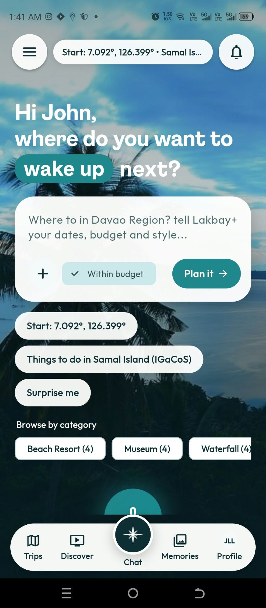
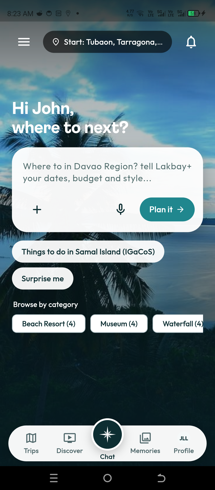
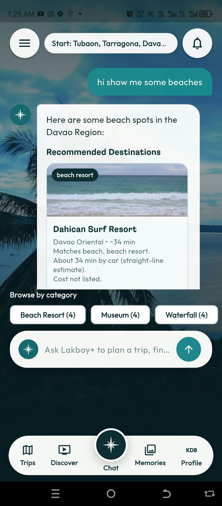
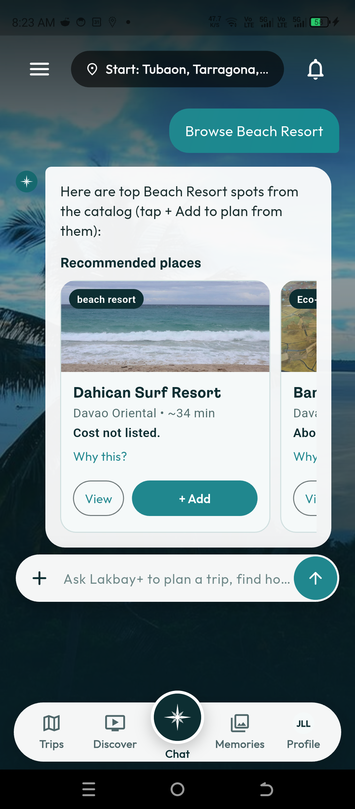

# Chat / Home redesign: verification record

Branch: `feature/redesign-phase7-verify`. Phases 1–6 are merged on local `main` (not yet pushed).
Device: Android phone `10944373BA109672`, Phase 6 build (includes the round 44 dp send button).

## Before and after

| Screen | Before | After |
|---|---|---|
| Home (idle) |  |  |
| Chat answer |  |  |

Also captured on the phone: [Discover](redesign/after_discover.png), [Trips](redesign/after_trips.png), [Place](redesign/after_place.png).

## What changed (from the plan)

- "1 DAYS" fixed: a one-day trip now shows only its kind (`DayLabels`).
- Header: hamburger and bell are plain icons (no circle border), 48 dp targets; named start-place pill.
- Home: one headline and one composer; extras moved into the "+" menu (New chat, Within budget, Set starting place).
- Chat: category strip removed (now "Browse categories" in the "+" menu); place carousel cards; "Why this?" sheet; bottom bar hides while scrolling down.
- Motion: shared-axis page pushes, opacity-only tab fade, card-to-page container transform on chat place cards, staggered new messages. All respect Android "Remove animations".
- Accessibility: contrast constants tested against WCAG, screen-reader names on icon-only controls, 48 dp targets, large-text fit.

## Measurements on the phone

| Check | Result |
|---|---|
| Cold start | 662–781 ms |
| Chat scroll | 4.7% slow frames |
| Discover scroll | 3.2% slow frames |
| Tab switching | p99 about 16.8 ms, worst 25 ms (steady state); 13–17% of frames at a 16.7 ms step |

Method: `dumpsys SurfaceFlinger --latency` on the app's SurfaceView layer (gfxinfo reports nothing for Flutter).
Note: the first tab-fade version (fade plus scale) cost 56–75% slow frames; it was changed to opacity only.

## Automated tests

Traveler app suite: 257 passing at the last full run (phase 1–6 redesign tests, day labels, commute directions, and others).

## Not checked (honest list)

- TalkBack was not run on the phone; screen-reader names and selected state are covered by widget tests only.
- Large text (1.3x, 1.6x) was tested in widget tests on 360 x 640 and 320 wide, not on the phone.
- The staggered message entrance was not observed on screen.
- Discover list cards still use the normal push; the container transform exists only on chat place cards.
- The "Why this?" sheet was verified in tests, not on the phone.
- The reworded route notes in `services/api/app/features/routes/service.py` reach travelers only after a Render deploy.

## Not pushed

Redesign phases 1–6, the day-count fix and this record are local only.
